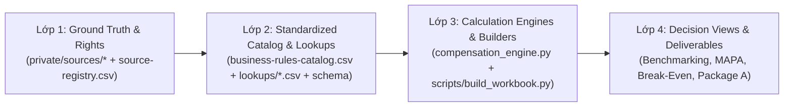

# Kiến trúc Dữ liệu Cấu hình & Mô hình Tái sử dụng (Conceptual Target Architecture — TO-BE vs AS-IS)

**Phiên bản:** 1.1 *(Cập nhật Hardening Level 2 — Phân biệt rõ Kiến trúc Mục tiêu [TO-BE] với Hiện trạng [AS-IS])*  
**Trạng thái Thực thi Hiện tại (`VERIFIED FACT`):**
- Tài liệu này mô tả **kiến trúc mục tiêu 4 lớp (`CONCEPTUAL TARGET ARCHITECTURE`)**.
- Tại **Level 2 hiện tại**, `model/compensation/compensation_engine.py` đã nạp trực tiếp 3 file lookup CSV (`knowledge/lookups/*.csv`) và tham số hóa `ProposalParams`, nhưng **chưa đọc trực tiếp `business-rules-catalog.csv` hay `schemas/compensation-scheme.schema.json` ở runtime** (thêm công ty mới hiện vẫn cần thêm hàm/adapter mới).
- Xem bản đồ phụ thuộc thực tế, phân loại tham số và lộ trình chuyển dần sang Level 3/4 tại [level3-level4-architecture-advisory.md](./level3-level4-architecture-advisory.md).

---

## 1. Nguyên tắc Tách lớp (4-Layer Target Model)

1. **Lớp 1 — Ground Truth & Source Rights (`private/sources/` + `source-registry.csv`):** Bất biến (read-only), kiểm soát toàn vẹn bằng SHA-256 hash và gắn nhãn `Redistribution_Rights_Status` (`RESTRICTED_INTERNAL` / `PERMISSION_UNKNOWN` / `PUBLIC_DISTRIBUTION_AUTHORIZED`). *(Cập nhật sau `DEC-07` tại `5cb7a21`: repository hiện ở chế độ `PUBLIC` theo quyết định của TJ; xem [confidentiality-and-rights-policy.md](../governance/confidentiality-and-rights-policy.md) — chế độ PUBLIC không mặc nhiên xác nhận quyền tái phân phối tài liệu bên thứ ba).*
2. **Lớp 2 — Chuẩn hóa Dữ liệu (`business-rules-catalog.csv` + `knowledge/lookups/` + `schemas/compensation-scheme.schema.json`):**
   - **Đã chạy ở runtime (Level 2):** 3 bảng lookup CSV (`aia-paf-5y-targets.csv` 1,300 dòng, `chubb-product-commission-schedule.csv` 113 dòng, `chubb-hsbh-tiers.csv` 10 dòng) được chia sẻ đồng thời bởi Python engine và Excel workbook builder.
   - **Đang là hợp đồng kiểm định (mục tiêu Level 3):** `business-rules-catalog.csv` và `compensation-scheme.schema.json` được kiểm tra tự động qua `scripts/validate_repo.py` nhưng chưa trực tiếp điều phối tính toán runtime.
3. **Lớp 3 — Calculation Engines & Reproducible Workbook Build:**
   - Python Engine (`model/compensation/compensation_engine.py`) có validation chặt (`NaN/±Inf/UNKNOWN`) và bộ kiểm thử `unittest` tự động nhận diện (`python scripts/run_checks.py`).
   - Excel Reference Model được dựng tái lập từ code qua `scripts/build_workbook.py` (14 sheets, công thức tương thích Excel 12.0/2007, không ghi đè `v1.xlsx`) và kiểm chứng tính toán lại + biến thiên tham số trực tiếp bằng `scripts/verify_workbook_excel.py`.
4. **Lớp 4 — Decision Views & Tầm nhìn Mở rộng (P1/P2):**
   - **Đã có (Step 1 P0):** Competitor Benchmarking 12 phương pháp, MAPA xuôi/ngược, Phân tích độ nhạy điểm hòa vốn (`Modeled Break-Even Margin`), và Gói A (`outputs/interview/W24_Executive_Recommendation_Step1.md`).
   - **Hoãn sang P2/P3 (chưa triển khai trong Sprint Level 2):** HTML Interactive Simulator, phễu Marketing Tuyển Sales & Khách hàng, và hệ thống nạp dữ liệu VNB/OpEx thực tế.

---

## 2. Quy trình Cập nhật Hiện tại (Level 2) vs. Mục tiêu (Level 3–4)

- **Hiện tại (Level 2):** Thêm PDF mới vào `source-registry.csv` (kèm SHA-256 & `Redistribution_Rights_Status`) → trích xuất quy tắc vào `business-rules-catalog.csv` & lookup CSV → viết adapter/công thức tương ứng trong `compensation_engine.py` & `scripts/build_workbook.py` → chạy `python scripts/run_checks.py` và `scripts/verify_workbook_excel.py`.
- **Mục tiêu Level 3–4:** Xem tiêu chí nghiệm thu chi tiết tại [level3-level4-architecture-advisory.md](./level3-level4-architecture-advisory.md).
