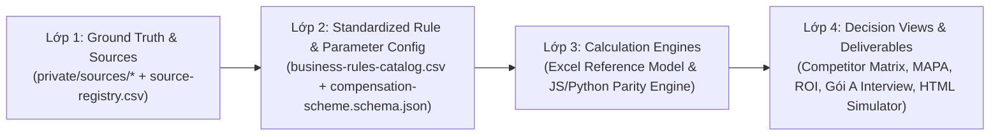

# Kiến trúc Dữ liệu Cấu hình & Mô hình Tái sử dụng (Reusable Model Architecture)

**Phiên bản:** 1.0  
**Mục tiêu:** Cho phép TJ bổ sung thêm PDF chính sách đối thủ mới (ví dụ: Manulife Đại lý, AIA Truyền thống, Prudential, Dai-ichi) hoặc đề xuất chính sách (Proposal) mới vào hệ thống mà **không phải thiết kế lại** Excel Reference Model, MAPA, Recruitment/Customer Marketing, Financial Model hay HTML Interactive Simulator.

---

## 1. Nguyên tắc Tách lớp (Separation of Concerns)

Hệ thống tách thành 4 lớp độc lập để dễ kiểm thử, dễ kiểm toán và mở rộng sang HTML Simulator:

1. **Lớp 1 — Ground Truth (`private/sources/` + `source-registry.csv`):** Bất biến (read-only), kiểm soát bằng SHA-256 hash, không commit PDF nội bộ vào Git.
2. **Lớp 2 — Cấu hình Chuẩn hóa (`business-rules-catalog.csv` + `schemas/compensation-scheme.schema.json`):** Mọi chính sách đối thủ và proposal đều mô tả bằng cùng 1 ngôn ngữ dữ liệu:
   - **Tầng bậc chuẩn (`target_tier`):** Tách rõ `Individual_Agent` (Tầng 1), `Mid_Management` (Tầng 2), `Senior_Executive_Leader` (Tầng 3) để tránh lỗi so sánh lệch tầng (ví dụ: không so Manulife `PSM+` với AIA `CVTV`).
   - **Quy đổi chỉ số (`metric_definitions`):** Khai báo rõ từng hãng định nghĩa `FYP` thế nào (Top-up 0% như AIA/Chubb mới vs. 6% như Manulife PSM+), `Active` thế nào (`1mAA ≥ 4tr FYC` vs. `EHC`), và `Persistency` tính theo khung nào (`AIA FY 14M`, `AIA TOT`, `Manulife K2`, `Chubb K2/P13`).
   - **Cơ chế tính chuẩn (`calc_mode`):** Thay vì hard-code từng công ty vào công thức, mọi khoản thu nhập đều thuộc 1 trong 7 kiểu toán học chuẩn: `flat_rate`, `marginal_tiered`, `retroactive_tiered`, `fixed_amount`, `multiplier_on_component`, `excess_over_target`, `max_of_components`.
   - **Cờ quyền chỉnh sửa (`po_editable`):** Phân tách rõ theo **PO Decision Bridge**: tham số của đối thủ (`po_editable = false`, khóa Ground Truth) vs. tham số của Proposal đề xuất (`po_editable = true`, PO được chỉnh trong khoảng hợp lệ).
3. **Lớp 3 — Calculation Engines (Excel Reference Model & Parity Engine):**
   - Trong Excel (Ngày 2), các sheet tính toán (`Calc_Agent`, `Calc_Manager`, `Calc_Senior`, `MAPA`, `Financial_ROI`) đọc tham số từ bảng `Parameters` & `Scheme_Config` qua `INDEX/MATCH` / `IFS` / `SUMIFS` — **không hard-code tỷ lệ đối thủ vào ô công thức**.
   - Golden Test Cases (`tests/`) kiểm chứng công thức Excel độc lập bằng Python, và sau này dùng chính bộ JSON/CSV cấu hình + Golden Test Cases đó để chạy **Parity Test** với HTML/JavaScript Simulator.
4. **Lớp 4 — Liên kết sang Tầm nhìn Mở rộng của TJ (P1/P2):**
   - **MAPA (Xuôi & Ngược):** Kết nối trực tiếp qua `planning_linkages.mapa_drivers_targeted` (`Manpower`, `Active_Ratio`, `Productivity`, `Average_Case_Size`, `Persistency_K2`).
   - **Marketing Tuyển Sales → Manpower & Active Ratio:** Đầu ra chi phí tuyển/đại lý hoạt động cộng với chi phí `Activation / Onboarding` trong chính sách thu nhập để tính **Total Acquisition Cost per Productive Agent**.
   - **Marketing Tìm Khách hàng → Productivity & Average Case Size:** Chỉ cộng phần **doanh số tăng thêm (Incrementality)**, không cộng trùng với doanh số MAPA gốc.
   - **Financial Model & ROI:** Tách riêng `Total Comp Earned` vs. `Cash Paid Year 1` vs. `Deferred Vesting Year 2-4` vs. `Expected Clawback`, đối chiếu với `Contribution / VNB` (qua phân tích độ nhạy & điểm hòa vốn khi chưa có VNB margin nội bộ).

---

## 2. Quy trình 4 bước khi TJ nạp thêm PDF Đối thủ hoặc Proposal mới

1. Đặt PDF mới vào `private/sources/<Company>/` và ghi 1 dòng vào `knowledge/sources/source-registry.csv` (kèm SHA-256 hash).
2. Trích xuất các điều khoản vào `knowledge/business-rules/business-rules-catalog.csv` (ghi rõ `Source_ID`, `Version`, `Page`).
3. Điền 1 cột/khối cấu hình mới theo `schemas/compensation-scheme.schema.json` vào bảng `Scheme_Config` trong Excel (chỉ mất 10–15 phút, không sửa công thức engine).
4. Chạy bộ `QA Tests` & so sánh tự động trên 7 hồ sơ đại lý chuẩn + kịch bản MAPA/ROI.
