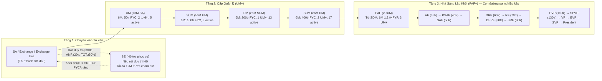

# Policy Knowledge Base — AIA Việt Nam: Kênh Alpha (2026)

**Nguồn Ground Truth đã đọc trọn 62/62 trang:**
- `SRC-POL-AIA-ALP-001`: `AIAV/AD/2604-069` (03/04/2026, hiệu lực 01/04/2026) — Chính sách Chuyên Viên Tư Vấn (CVTV) + Phụ lục 2 (JFW CQL) + Phụ lục 3 (Đồng hành 3 tháng đầu) [23 trang].
- `SRC-POL-AIA-ALP-002`: `AIAV/AD/2601-034` (03/02/2026, hiệu lực 03/02/2026) — Chính sách Cấp Quản Lý (CQL: UM/SUM/DM/SDM) [21 trang].
- `SRC-POL-AIA-ALP-003`: `AIAV/AD/2601-035` (03/02/2026, hiệu lực 03/02/2026) — Chính sách Nhà Sáng Lập Khối (`PAF+` đến `SPVP` / `VP+`) [18 trang].

> **Lưu ý Ground Truth:** Cả 3 thông báo đều ban hành bởi Phó Tổng Giám Đốc Phát Triển Kinh Doanh AIA Việt Nam (Vũ Thị Thu Uyên) → **xác minh 100% Kênh Alpha là kênh kinh doanh trực thuộc Công ty TNHH BHNT AIA Việt Nam**, có sự tham gia của "Nhà đồng sáng lập Alpha" trong quy trình phỏng vấn & phê duyệt thăng cấp UM+.

---

## 1. AIA Việt Nam đang xây dựng Kênh Alpha theo mô hình nào?

- **Mô hình Hybrid Toàn thời gian & Doanh chủ (Dual Career + MDRT Factory):**
  - Ở **tuyến đại lý (CVTV)**, AIA Alpha phân thành 3 phân nhóm rõ rệt: `SA` (Chuyên viên Tư vấn chuẩn), `Exchange` (Chuyên viên Hoạch định Tài chính) và `Exchange Pro` (Chuyên viên Hoạch định Tài chính Cấp cao). Chính sách đẩy thưởng tuyển dụng/đồng hành gấp **2× (Exchange)** và **4× (Exchange Pro)** so với SA thường, đồng thời nhân đôi trọng số lượt hoạt động (`1mAA Exchange/Pro = 2 lượt`) cho chỉ tiêu PAF+.
  - Ở **tuyến quản lý (UM+ → PAF+)**, AIA tạo **"Con đường sự nghiệp kép"** cho tầng Nhà Sáng Lập Khối (`PAF+`): vừa đóng vai trò **Quản trị khối/vùng có Phí cố định hàng tháng (20–130 triệu)** và chỉ tiêu tăng trưởng 5 năm, vừa đóng vai trò **Doanh chủ** (được phép bán cá nhân nhận full thưởng CVTV và quản lý nhóm trực tiếp nhận phí CQL trực tiếp).

---

## 2. Lộ trình Cấp bậc từ Gia nhập đến Đỉnh hệ thống

- **Quy tắc chống phụ thuộc 1 nhánh (`70% Concentration Cap`):** Khi xét thăng cấp hoặc duy trì chức danh (từ `SUM` trở lên đến `VP`), không một nhóm trực tiếp hay nhánh con nào được đóng góp quá **70%** tổng chỉ tiêu yêu cầu (`2601-034 p.9`, `2601-035 p.6-7`).
- **Quy định báo cáo đồng cấp:** Quản lý mẹ đồng cấp với quản lý con chỉ được bảo lưu quyền lợi trong **12 tháng** (UM / PAF–SAF), **18 tháng** (SUM / DRF–SRF), hoặc **24 tháng** (DM/SDM / PVP–VP). Quá hạn sẽ tách nhánh lên cấp trên. Riêng PAF+ từ Q2/2026: nếu mẹ **thấp cấp hơn** con (vượt cấp), tách nhánh **ngay lập tức** (`2601-035 p.8`).

---

## 3. Cấu trúc Thu nhập Chi tiết & Điều kiện Nhận

### 3.1. Tầng 1 — Chuyên Viên Tư Vấn (`SA / UM+ / PAF+` bán cá nhân)

| Khoản thu nhập | Cơ sở tính & Mức chi trả | Điều kiện cốt lõi & Ngoại lệ | Nguồn |
|---|---|---|---|
| **Hoa hồng (FYC / RYC / SYC)** | Theo Phụ lục hoa hồng sản phẩm *(thiếu phụ lục trong bộ file)*. | Tính trên phí thực thu; không bị chặn bởi "xét trả" kỷ luật nhưng vẫn bị thu hồi 6 tháng nếu hủy HĐ. | `001 p.12,18` |
| **Thưởng 1/72H (Kích hoạt siêu tốc)** | **1.5 triệu VND** cố định. | Trong **4 ngày làm việc đầu** từ ngày cấp mã: nộp ≥1 HĐ & ≥4tr FYC Tín Chỉ; duyệt ≤30 ngày. Loại trừ: HĐ tự mua/bán cho CVTV khác, Exchange/Pro (không tính trùng hỗ trợ), AFF, PAF+, SP loại trừ. | `001 p.4` |
| **Đồng hành 3 tháng đầu (SA mới T1–T6/2026)** | **1.5 triệu/M** (≥5tr FYC TC) hoặc **3 triệu/M** (≥10tr FYC TC). | Chấm công **≥50%**, có **ACK hợp lệ trong 15 ngày** và **qua 21 ngày cân nhắc**. Loại trừ Exchange/Pro/AFF/PAF+ và HĐ đã nhận 1/72H. | `001 p.22-23` |
| **Chuyến Huấn luyện Đặc biệt (3M đầu)** | 1 vé (không quy đổi tiền, không thu hồi). | Trong 3M đầu (duyệt ≤3M+5 ngày): ≥40tr FYC TC thuần + ≥5 HĐ thuần + 3/6 khóa SB1–SB6. Loại trừ PAF+. | `001 p.4-5` |
| **Thưởng Doanh Số Cá Nhân Quý** | `FYC TC Quý × Tỷ lệ (4% → 40%) × Hệ số FY Quý` (8 bậc: `16tr:4%, 20tr:10%, 35tr:15%, 50tr:20%, 70tr:25%, 90tr:30%, 120tr:35%, ≥150tr:40%`). | Nếu chưa tròn quý: quy đổi lên mức tròn quý (Q1 theo ngày; từ Q2 nhân `3 / số tháng từ tháng gia nhập`) để tìm % thưởng, rồi nhân với FYC thực đạt. | `001 p.5-6` |
| **Thưởng Chuyên Viên Ngoại Hạng Quý** | `FYC TC Quý × (5% [3S] / 10% [4S] / 15% [5S]) × Hệ số FY Quý`. | 3S: ≥20tr & ≥2M active; 4S: ≥35tr & 3M active; 5S: ≥70tr & 3M active. Cổng FY 2026: 65%(3-4S)/75%(5S) → **2027 tăng lên 70%/80%**. | `001 p.3,6` |
| **Thưởng Chất Lượng Dịch Vụ Quý (SYC)** | `SYC Quý × 30% (4 Sao)` hoặc `× 50% (5 Sao)`. | Đạt danh hiệu Ngoại hạng Quý 4 Sao hoặc 5 Sao. | `001 p.6` |
| **Thưởng Doanh Số Cá Nhân Năm** | `FYC TC Năm × (6% [150tr] / 10% [300tr] / 14% [800tr] / 20% [≥1,600tr]) × Hệ số FY Năm`. | Tính theo năm tài chính 01/01–31/12/2026. Đỉnh cộng dồn biến đổi (Quý + Ngoại hạng + Năm) ở FY đỉnh 120% đạt **`90% FYC`**. | `001 p.7` |
| **Gói Bảo hiểm Sức khỏe (1 năm)** | Tiêu chuẩn (≥3 lần 4S+, FY≥65%) / Cao cấp (≥3 lần 5S, FY≥75%). | Không quy đổi tiền, không thu hồi, nhưng chấm dứt hiệu lực ngay nếu chấm dứt HĐĐL. | `001 p.7` |
| **Phí Giới thiệu CVTV Mới (12M đầu)** | `FYC TC của CVTV mới × (5% SA / 10% Exchange / 20% Exchange Pro)`. | Trả hàng tháng trong tháng chuẩn 1–12 (M0 gộp vào M1). Tạm khấu trừ 10% thuế TNCN. Nếu SA lên UM+ sẽ chuyển sang nhận mức CQL (gấp đôi!). | `001 p.7-8` |

### 3.2. Tầng 2 — Cấp Quản Lý (`UM / SUM / DM / SDM`)

| Khoản phí dịch vụ | Công thức & Mức chi trả | Điều kiện cốt lõi | Nguồn |
|---|---|---|---|
| **Tuyển dụng hiệu quả (Non-JFW) & JFW Tháng** | `FYC TC NTT × (8/12/15/20% nếu FY<80% \| 10/15/18/24% nếu FY≥80%)` theo 4 bậc FYC NTT (`<7 / ≥7 / ≥20 / ≥50tr`). | Doanh số JFW bao gồm cả bán cá nhân CQL và cần khai báo JFW trung thực. Phải duy trì chức danh UM+. | `002 p.3`, `001 p.21` |
| **Tuyển dụng chất lượng Tháng (Activity)** | `FYC TC NTT × (5% [≥2 active] / 8% [≥4] / 12% [≥6]) × Hệ số FY (≥70%:100%, <70%:%FY)`. | **Chấm công cá nhân ≥50%/tháng** (miễn tháng bổ nhiệm & thai sản). | `002 p.3` |
| **Đào tạo nhóm gián tiếp Tháng (Gen 2–4)** | **50% (Cấp 2) / 25% (Cấp 3) / 12.5% (Cấp 4)** trên `(Phí TD hiệu quả + Phí JFW)` của CQL con. | Không áp dụng cho `PAF+`. Tuân thủ hạn đồng cấp 12/18/24 tháng. | `002 p.4` |
| **Tuyển dụng CVTV thăng tiến UM mới (12M)** | **150%** trên `(Phí TD hiệu quả + JFW)` của UM mới lần đầu, **tối đa 30 triệu/tháng/UM**. | FY NTT của CQL mẹ **≥75%**. Chấm dứt ngay nếu mẹ hoặc con bị giáng xuống CVTV/SE. | `002 p.4` |
| **Nâng cao kỹ năng NTT Quý (CQL Ngoại hạng)** | `FYC TC NTT Quý × (5% [3S] / 8% [4S] / 15% [5S])`. | Chấm công ≥50%; FY ≥75%; FYC NTT `50/80/170tr`; active `6/9/14`; tuyển mới hoạt động Q1 `≥1`, **từ Q2 `≥2` với 4S–5S** (**Exchange Pro tính = 2 CVTV mới!**). | `002 p.4-5` |
| **Nâng cao kỹ năng NTT Năm (Trả chậm 3 năm!)** | `FYC TC NTT Năm × (5% [4S năm] / 10% [5S năm])`. **Trả 3 đợt: 15% (01/2028) – 25% (01/2029) – 60% (01/2030)!** | FY năm ≥75% + đạt ≥3 lần Quý (≥2 lần nếu mới bổ nhiệm 2026). **Điều kiện giải ngân từng đợt: vẫn là CQL & `AIA TOT ≥ 85%`!** | `002 p.5` |
| **Đồng hành CVTV mới (12M đầu)** | Tuyển trực tiếp: **`10% (SA) / 20% (Exchange) / 40% (Exchange Pro)`** FYC CVTV mới. Qua SA giới thiệu: chia đôi `5% / 10% / 20%`. | Ngưng trả nếu CQL bị hạ xuống SA. Tiếp tục trả kể cả khi CVTV mới thăng cấp lên UM+ trong 12M đầu! | `002 p.6-7` |

### 3.3. Tầng 3 — Nhà Sáng Lập Khối (`PAF+`: 10 bậc có biểu phí cố định đến `SPVP`)

| Khoản phí dịch vụ | Công thức & Mức chi trả | Điều kiện & Giới hạn | Nguồn |
|---|---|---|---|
| **Phí Đào tạo Cơ bản Tháng (Cố định có KPI)** | `Phí cố định (20tr PAF → 130tr SPVP) × % theo FYP toàn nhánh (<35%:0%, 35–55%:50%, 55–115%:100%, ≥115%:120%) × Chuyên cần (≥70%:100%, <70%:70%)`. | Chỉ tiêu 5 năm tăng dốc (VD: PAF từ 1.8 tỷ → 4.8 tỷ FYP; SPVP từ 30 tỷ → 62.3 tỷ FYP; tháng 1–2 giảm tải và dồn bù vào tháng 11–12). | `003 p.3,9-12` |
| **Phí Đào tạo Chuyên nghiệp Tháng** | Trực tiếp: `FYC × (0/3/4.5/6% theo FYP × Hệ số FY 0–120%) + FYC × (0/1.5/2.5/3.5% theo 1mAA)`. **Gián tiếp: 50% chuỗi vô hạn tầng** (`50%, 25%, 12.5%, 6.3%, 3.1%, 1.6%...`). | Khối trực tiếp PSAF+ áp chỉ tiêu PAF nếu không có thỏa thuận riêng. FY `<50%` cắt phần FYP về `0%`. | `003 p.4` |
| **Phí Đào tạo Chuyên nghiệp Quý** | Trực tiếp: `FYC Quý × (0/0.5/2/3.5/5% theo FYP × Hệ số FY) + FYC Quý × (0/0.5/1.5/2.5/3.5% theo 1mAA)`. Gián tiếp: 50% chuỗi. | Ngưỡng đạt chỉ tiêu cao hơn tháng (`≥90%` mới bắt đầu có thưởng). | `003 p.4-5` |
| **Phí Thâm niên (M12/24/36/48/60)** | `(FYP thực đạt − Chỉ tiêu FYP) × (5% Năm 1; Năm 2+: FY<55%:0%, 55–65%:4%, 65–70%:5%, ≥70%:6%)`. | **Cap = tổng Phí cơ bản đã nhận trong 12M qua.** **Clawback 100% nếu nghỉ việc hoặc mất chức danh PAF+ trong vòng 12M kể từ tháng nhận phí!** | `003 p.5` |
| **Quyền lợi Dual Career (Cộng thêm)** | Được hưởng thêm toàn bộ chính sách CVTV + CQL trực tiếp (từ 01/01/2026) và miễn xét duy trì hợp đồng CVTV/CQL. | **Loại trừ:** Không nhận 1/72H, Chuyến HL đặc biệt, Exchange/Pro, AFF, và **không nhận override gián tiếp CQL cấp 2–3–4** (tránh hưởng trùng với chuỗi 50% của PAF+). | `003 p.2` |

---

## 4. Cách tăng thu nhập — Khi nào bị giảm / mất thu nhập

- **4 đòn bẩy tăng thu nhập mạnh nhất trong AIA Alpha:**
  1. **Giữ `AIA FY ≥ 85%` (2026) / `≥ 90%` (2027):** Nhân **120%** lên toàn bộ thưởng Quý, Ngoại hạng, Năm, đồng thời mở khóa cột 24% Direct Override CQL (thay vì 20%) và thưởng **50% SYC** (5 Sao).
  2. **Tuyển và nâng cấp ứng viên vào `Exchange Pro`:** Tỷ lệ thưởng đồng hành tăng vọt từ 10% lên **40% FYC trong 12 tháng** và được tính **×2 lượt tuyển mới / ×2 lượt 1mAA**.
  3. **Nhân bản `UM` mới:** CQL nhận **150%** phí tháng của UM mới trong 12 tháng (tối đa 30tr/tháng/UM) + 50% override gián tiếp.
  4. **Lên `PAF+` hưởng Dual Career:** Vừa nhận cố định 20–130tr/tháng + chuỗi gián tiếp nhiều tầng, vừa giữ nguyên doanh số cá nhân & nhóm trực tiếp.
- **5 cơ chế làm giảm / mất sạch thu nhập (Downside & Clawback):**
  1. **Vách đá Persistency từ 2027:** `AIA FY < 70%` làm toàn bộ Thưởng DS Quý, Ngoại hạng Quý và DS Năm của CVTV rơi về **`0%`** (so với 2026 vẫn nhân theo `%FY`).
  2. **Thu hồi 6 tháng không phân biệt trạng thái hợp đồng:** Hủy HĐ trong 6 tháng đầu → trừ ngược về tháng phát sinh, tính lại và thu hồi toàn bộ hoa hồng, thưởng, phí dịch vụ **kể cả khi đại lý/CQL đã nghỉ việc**.
  3. **Vi phạm kỷ luật / chấm công / khóa học:** Cảnh cáo lần cuối cắt **30%** thưởng; chấm công `<50%` mất Activity Bonus & Premier CQL Quý; PAF+ chấm công `<70%` bị cắt **30%** phí cố định; PAF+ thiếu khóa học bị **tạm giữ toàn bộ thu nhập kể cả vai trò CVTV/CQL**.
  4. **Giáng cấp / Chuyển sang SE:** Không đạt duy trì 1 quý → CVTV rơi xuống `SE` (chỉ nhận hoa hồng, cắt 100% thưởng; UM+ rơi xuống SE bị **xóa sổ toàn bộ cấu trúc nhóm**).
  5. **Bỏ cuộc sớm mất thưởng dài hạn:** CQL rời vị trí hoặc `AIA TOT < 85%` mất khoản trả chậm 2028–2030 (60% dồn ở năm 2030!); PAF+ rời chức danh trong 12 tháng sau khi nhận phí thâm niên bị **thu hồi 100%**.

---

## 5. Ví dụ Minh họa Tính toán Thực tế (Từ Quy tắc Gốc)

> **Tình huống:** Một **UM** có nhóm trực tiếp (gồm cá nhân UM) đạt **60 triệu FYC Tín Chỉ/tháng** (180tr/quý), có **6 lượt active/tháng**, tuyển được **1 Exchange Pro** mới tạo ra **15 triệu FYC/tháng**, chấm công 60%, `AIA FY = 82%` (năm 2026):
> - **Phí TD hiệu quả / JFW tháng:** `60tr × 24% (≥50tr, FY≥80%) = 14.4tr/tháng`.
> - **Phí TD chất lượng (Activity):** `60tr × 12% (≥6 active) × 100% (FY≥70%) = 7.2tr/tháng`.
> - **Phí Đồng hành Exchange Pro (12M):** `15tr × 40% = 6.0tr/tháng`.
> - **Phí Nâng cao kỹ năng Quý (5 Sao: ≥170tr, 18 active ≥14, 1 Exch Pro = 2 mới, FY≥75%):** `180tr × 15% = 27.0tr/quý` (`9.0tr/tháng`).
> - **Tổng thu nhập quản lý nhóm trực tiếp (chưa gồm hoa hồng/thưởng bán cá nhân & 10% thưởng năm trả chậm 2028–2030):** `14.4 + 7.2 + 6.0 + 9.0 = 36.6 triệu/tháng` (**61.0% trên FYC nhóm trực tiếp** — trong đó riêng khoản đồng hành 40% trên Exchange Pro chiếm 16.4% tổng thu nhập quản lý!).

---

## 6. Nghĩa vụ Tài chính Ngắn hạn & Dài hạn của Doanh nghiệp

- **Ngắn hạn (Tháng / Quý):** Thanh toán 2 kỳ/tháng (Kỳ 1: ngày 10–12; Kỳ 2: ngày 28–30; PAF+ trả ngày 08–10). Áp lực dòng tiền lớn nhất đến từ: (a) Phí cố định PAF+ (20–130tr/tháng/người), (b) Phí đồng hành 40% Exchange Pro kéo dài 12 tháng, (c) Phí thăng tiến UM 150% (tối đa 30tr/tháng/UM) và chuỗi 50% nhiều tầng PAF+.
- **Dài hạn (1–4 năm):** (a) Dự phòng khoản trả chậm **3 năm** cho CQL Ngoại hạng năm (`15% [2028] – 25% [2029] – 60% [2030]`, chỉ giải ngân nếu `TOT ≥ 85%`); (b) Phí thâm niên PAF+ tại M12/24/36/48/60; (c) Thưởng SYC 30–50% năm 2 và gói bảo hiểm sức khỏe 1 năm.
