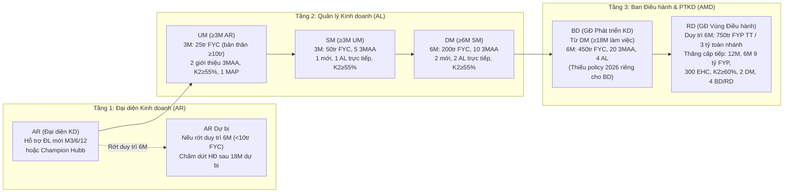

# Policy Knowledge Base — Chubb Life Việt Nam: Kênh Đại lý (2026)

**Nguồn Ground Truth đã đọc trọn 48/48 trang:**
- `SRC-POL-CHB-001`: `CHH0DCEB260007V` (hiệu lực 01/01/2026) — Chính sách thu nhập Đại lý bảo hiểm + Phụ đính I (Champion Hubb Cá nhân) + Phụ đính II (Full Biểu tỷ lệ Hoa hồng sản phẩm từ 01/01/2025) [19 trang].
- `SRC-POL-CHB-002`: `CHH0DCEB260008V` (hiệu lực 01/01/2026) — Chính sách phí dịch vụ Cấp Quản lý Kinh doanh, Hỗ trợ Kinh doanh + Phụ đính III (Champion Hubb Quản lý) [14 trang].
- `SRC-POL-CHB-003`: `CHH0DCEB260003V` (hiệu lực 01/01/2026) — Chính sách phí dịch vụ Giám đốc Vùng Điều hành & Phát triển Kinh doanh (`RD`) [15 trang PDF scan — đã đọc trực quan 15/15 trang].

---

## 1. Chubb Life đang xây dựng Kênh Đại lý theo mô hình nào?

- **Mô hình Kênh Đại lý Truyền thống Năng suất cao (High-Variable Production) kết hợp Chương trình "Champion Hubb" Kỷ luật Hành vi:**
  - **Cốt lõi Đại lý/Quản lý (`AR / AL`):** Không trả lương cứng/trợ cấp cố định đại trà, mà dồn ngân sách vào **thưởng biến đổi theo tháng + nhân chồng theo quý** ở mức cực cao cho người có doanh số đều đặn (`Rolling 3-month FYC` + `EHC` hàng tháng) và đặc biệt ưu ái **người gắn bó thâm niên** (`≥13 tháng` với AR, `≥15 tháng` với AL).
  - **Nhánh chuyên nghiệp hóa (`Champion Hubb`):** Dành cho AR/AL tự nguyện đăng ký và tuân thủ kỷ luật **SOP 3 buổi sáng/tuần (9h–11h)** và **20 bài Phân tích nhu cầu (FNA)/tháng** ghi nhận qua app Smart Agency, có mức thưởng cố định theo số hợp đồng (`CC` với `FYP ≥ 15tr/HĐ`) trong năm 1 rồi chuyển sang thưởng gắn `RYC năm 2 × K2` trong năm 2!
  - **Cấp lãnh đạo vùng (`AMD: BD → RD`):** Tách khỏi chế độ đại lý sang **Hợp đồng dịch vụ có biên bản nghiệm thu hàng tháng/quý**, trả phí theo đầu việc đào tạo (số lớp ≥4 học viên), số người hoạt động (`EHC / 3MAA`), **tốc độ tăng trưởng FYP (QoQ / YoY)** và chất lượng tái tục (`RYC Y2–Y5`).

---

## 2. Lộ trình Cấp bậc từ Gia nhập đến Giám đốc Vùng (`RD`)

- **Quy định giữ chất lượng thăng/duy trì:** AL có thâm niên `3–<6M` phải xong **≥1 khóa MAP**, từ `6M+` phải xong **≥2 khóa MAP** — thiếu khóa MAP bị **giáng 1 bậc** ngay cả khi đủ doanh số (`0007V p.8`).
- **Báo cáo đồng cấp RD–RD:** Duy trì tối đa **24 tháng**, sau đó RD con tách lên báo cáo cấp trên liền kề (`0003V p.12`).

---

## 3. Cấu trúc Thu nhập Chi tiết & Điều kiện Nhận

### 3.1. Biểu Hoa hồng Sản phẩm Chuẩn (`Phụ đính II — CHH0DCEB260007V p.13-19`)

*(Duy nhất trong bộ tài liệu G1 cung cấp full biểu hoa hồng thực tế theo từng sản phẩm! **Đã chuẩn hóa 100% toàn bộ 113 dòng sản phẩm/phí trội/rider/nhóm** vào [chubb-product-commission-schedule.csv](../lookups/chubb-product-commission-schedule.csv) và **10 khung tuổi HSBH** vào [chubb-hsbh-tiers.csv](../lookups/chubb-hsbh-tiers.csv). **Lưu ý Post-Audit:** Không được tổng quát hóa toàn bộ UL/ILP = 30% và Top-up = 0%, vì *KHTC Tương lai* (không có QL người giám hộ tử vong) = **27% Y1** (`p.16`), *KHTC Cao niên* = **20% Y1** (`p.13`), *Hoạch định TC ≤20t* = **25% Y1** (`p.15`), và các sản phẩm UL cũ vẫn trả Phí trội **1.5%–7%** [VD *Toàn diện 2013*: Y4 4%, Y5 3%, Y6 2%]. Bảng dưới chỉ trích các dòng tiêu biểu).*

| Dòng sản phẩm tiêu biểu (áp dụng HĐ từ 01/01/2025) | Năm 1 | Năm 2 | Năm 3 | Năm 4–5 | Năm 6–10 | Phí trội (Top-up) |
|---|---|---|---|---|---|---|
| **Kế hoạch Tài chính Linh hoạt / Chủ động (UL/ILP, ≥18t) / Bệnh Nan Y (<55t, Nửa năm/Năm)** | **30.0%** | **15.0%** | **8.0%** | **6.0%** | 1.5%–2.0% | **0.0% (Mọi năm!)** |
| **Chubb – Tự Do An Phúc (≥18t, theo Hệ số bảo hiểm HSBH)** | **25% / 27% / 30%** | 10.0% | 6.0% | 4.0% | 1.0% (11+: 0%) | **0.0%** |
| **Chubb – Tự Do An Phúc (<18t, theo HSBH)** | **20% / 22% / 25%** | 10.0% | 6.0% | 4.0% | 1.0% (11+: 0%) | **0.0%** |
| **Hoạch Định TC Tương Lai (>20t)** | **30.0%** | 10.0% | 10.0% | 8% / 6% | 4% (Y6) / 2% | 2.0% |
| **Tử kỳ 20 năm - 2010** | **35.0%** | 10.0% | 8.0% | 7% / 6% | 5.0% | — |
| **Riders Sức khỏe mở rộng (Tai nạn / Nằm viện / BHN) & Chubb Care (≥6t)** | **20.0%** | 8%–10% | 8%–10% | 6%–10% | 0%–1.5% | — |
| **Chubb – Tự Do An Lành (Sức khỏe) & Chubb Care Plus / Chubb Care (<6t)** | **10.0%** | 5%–10% | 5%–10% | 5%–10% | 0%–1.5% | — |

### 3.2. Tầng 1 — Thu nhập Cá nhân Đại lý (`AR / AL / AMD`) & Champion Hubb Cá nhân

| Khoản thu nhập | Công thức & Mức chi trả | Điều kiện cốt lõi & Cơ chế dòng tiền | Nguồn |
|---|---|---|---|
| **Thưởng HQKD Cá nhân Tháng** | `FYC Tháng × Tỷ lệ (theo FYC 3 tháng qua) × Hệ số K2`. • **AR (≥13M):** `5–10tr:7.5%`, `10–20tr:25%`, `20–40tr:35%`, `40–60tr:45%`, `≥60tr:55%`. • **AL/AMD (≥13M):** `15% / 40% / 50% / 60% / 70%`. • **ĐL <13M / chưa K2:** bị **chặn trần ở bậc 45% (AR) / 60% (AL)**. • **Hệ số K2:** `≥80%:120%`, `70–80%:100%`, `60–70%:75%`, `50–60%:50%`, `<50%:25%` (chưa K2: `100%`). | **Cơ chế chặn rủi ro dòng tiền cực hay:** • `K2 ≥ 60%`: tạm ứng 100% cuối tháng T, đối soát thu hồi tháng T+1 nếu có HĐ hủy. • `K2 < 60% hoặc chưa có K2`: **giữ đến tháng T+1 mới chi trả** sau khi đã trừ sạch HĐ hủy! | `001 p.4-5` |
| **Thưởng HQKD Cá nhân Quý (Nhân chồng)** | `Tổng Thưởng HQKD Tháng trong Quý × (0% [1 EHC] / 15% [2 EHC] / 30% [3 EHC])`. | Đỉnh cộng dồn khi đạt ≥60tr FYC/3M, K2 ≥80%, 3 EHC: **AR = `85.8% FYC`**, **AL bán cá nhân = `109.2% FYC`!** | `001 p.5-6` |
| **Thưởng Hoạt động Đại lý Mới (M3 / M6 / M12)** | `20% FYC` kỳ xét: M3 (6 CC, cap **6tr**); M6 (6 CC + khóa học, cap **10tr**); M12 (12 CC + khóa học, cap **20tr**). | Tổng tối đa **36 triệu/năm 1**. Thiếu khóa học bị cắt **50% thưởng**! So sánh `MAX()` với thưởng Champion Hubb. | `001 p.6` |
| **Thưởng Duy trì Chất lượng HĐBH Quý** | `RYC Quý (Y2–Y5) × (10% [2 EHC] / 15% [3 EHC])`. | Thâm niên ≥13 tháng và `K2 cá nhân ≥ 65%`. | `001 p.6-7` |
| **Champion Hubb Cá nhân (M1–M12 & M13–M24)** | • **M1–M6:** `3tr / 5tr / 7tr` (1/2/3 CC, FYP ≥15tr/HĐ) × `W1` (SOP). • **M7–M12:** Trả tháng `2tr/3tr/5tr` + **giữ lại trả tại M12** `1.2tr/2.4tr/2.4tr` × `W1` *(chỉ trả phần M12 nếu còn tham gia CH tại M12)*. • **Công thức bù trừ với Thưởng ĐL mới (`0007V p.10`):** Trừ `NewAgentBonus` vào phần trả tháng trước: `CH_Month_Net = MAX(0, CH_Month × W1 - NewAgentBonus)`, phần dư trừ tiếp vào cục M12: `CH_M12_Net = MAX(0, CH_M12 × W1 - MAX(0, NewAgentBonus - CH_Month × W1))` *(kiểm chứng khớp ví dụ M7 & M12 trang 10)*. • **M13–M24:** `(2tr + 20% RYC năm 2) × W1 (SOP) × W2 (K2: <50%:0%, 50–65%:30%, 65–75%:50%, 75–85%:100%, ≥85%:125%)`. | Yêu cầu **KPI ≥70%** (4 trụ: FYP 30tr [30%], 2 CC [30%], 20 FNA [25%], 100% SOP 3 buổi/tuần 9–11h [25%]). **Xung đột nội tại (`ERR-DOC-01` — `CONFLICTING_EVIDENCE`):** Bảng p.9 ghi `SOP 80–<90% → W1=80%`, nhưng ví dụ p.10 (M11 & M12) ghi `SOP=85% → W1=50%`. Không tự phán xử — mở 2 chế độ toggle trong mô hình. **Gian lận FNA → bồi hoàn cả AL lẫn AR!** | `001 p.9-12` |

### 3.3. Tầng 2 — Phí Dịch vụ Cấp Quản Lý (`AL: UM / SM / DM`) & Champion Hubb Quản lý

| Khoản phí dịch vụ | Công thức & Mức chi trả | Điều kiện cốt lõi & Ràng buộc | Nguồn |
|---|---|---|---|
| **Hỗ trợ Tuyển dụng & Đồng hành ĐDKD mới** | `10% FYC` AR mới trong M1–6 (trả hàng tháng) + **`10% FYC` tích lũy M7–12 (trả dồn 1 lần tại M12)**. | **Điều kiện kích thăng cấp rất sắc:** Để nhận cục M7–12, Người giới thiệu **phải lên UM hoặc duy trì AL tại tháng 12** của AR mới! | `002 p.4` |
| **Hỗ trợ Khai thác Nhóm Tháng (`HT KTN`)** | `FYC NTT (KHÔNG gồm bản thân AL) × Tỷ lệ × Hệ số K2 NTT (25%→120%)`. • AL ≥15M: `10–50%` (EHC <4) / **`20–60%`** (EHC ≥4) từ 5tr → ≥40tr FYC. • AL <15M: bị **chặn trần ở `25%` (EHC <4) / `35%` (EHC ≥4)** từ 20tr+. | Đỉnh tháng (AL ≥15M, ≥40tr, ≥4 EHC, K2 ≥80%): **`72% FYC NTT`**. **Nếu FYC NTT < 0 (do hủy HĐ), vẫn nhân tỷ lệ theo trị tuyệt đối để tính phí âm (clawback trực tiếp)!** | `002 p.5-6` |
| **Hỗ trợ Khai thác Nhóm Quý** | `Tổng Phí HT KTN Tháng trong Quý × (30% [15–35tr] / 35% / 40% / 45% / 50% [≥100tr])`. | Đỉnh cộng dồn trực tiếp (AL ≥15M): `72% × 1.5 =` **`108% FYC NTT`!** | `002 p.6-7` |
| **Quản lý Nhóm Tháng (Gián tiếp L1–L3)** | UM: L1; SM: L1+L2; DM: L1+L2+L3 trên `Phí HT KTN Tháng` của AL con. • **FYC NTT của chính AL `<15tr` → `0%` toàn bộ!** • `15–30tr`: `30% / 15% / 7.5%`; `≥30tr`: **`50% / 25% / 12.5%`**. | Chặn triệt để quản lý "ăn bám" hệ thống dưới khi nhóm trực tiếp của chính mình không đạt 15–30tr FYC/tháng! | `002 p.7` |
| **Đào tạo Nâng cao Chất lượng QL (12M)** | `+100%` Phí Quản lý nhóm tháng trên **UM mới** (cap **15tr/M**) và **SM mới** (cap **30tr/M**). | AL quản lý phải đạt `EHC NTT`: UM ≥2, SM ≥3, DM ≥4. Chỉ tính thăng cấp lần đầu. | `002 p.8-9` |
| **Duy trì Chất lượng HĐBH Quý (RYC NTT)** | `RYC NTT Quý (Y2–Y5) × (10% [2–4 3MAA] / 15% [≥5 3MAA])`. | Thâm niên ≥13M & `K2 NTT ≥ 65%`. | `002 p.9-10` |
| **Champion Hubb Quản lý (M1–24)** | M1–12: `3/5/7/9tr` (1/2/4/6 ĐL đạt CH); M13–24: `1.5/2.5/3.5/4.5tr` × `W1` (SOP của AL). | AL chỉ chọn 1 vai trò (Cá nhân HOẶC Quản lý). KPI nhóm CH ≥60%. Nhận `MAX(CH QL, Phí XD ĐVKD mới [260009V] + Phí đào tạo QL)`. | `002 p.11-14` |

### 3.4. Tầng 3 — Giám đốc Vùng Điều hành & PTKD (`RD` — `CHH0DCEB260003V`)

| STT | Khoản phí dịch vụ RD | Công thức & Mức chi trả | Cổng Chất lượng & Điều kiện | Nguồn |
|---|---|---|---|---|
| 1 | **Đào tạo tiêu chuẩn Tháng** | `25tr` (FYP báo cáo ≥400tr) / `12.5tr` (<400tr) × tỷ lệ lớp (`≥4 lớp:100%, 3:75%, 2:50%, <2:0%`). | FYP báo cáo = `100% TT + 50% C1 + 25% C2 + 12.5% C3`. Mỗi lớp phải **≥4 học viên**. | `003 p.5` |
| 2 | **Quản lý Hoạt động Tháng** | Cố định bậc thang `1.5tr → 8.0tr` theo `4 → ≥20 EHC` nhánh trực tiếp. | Dưới 4 EHC = `0đ`. | `003 p.6` |
| 3 | **Quản lý Kinh doanh Tháng** | Cố định bậc thang `2.5tr → 12.0tr` theo `120tr → ≥600tr FYP` nhánh trực tiếp. | Dưới 120tr FYP = `0đ`. | `003 p.6` |
| 4 | **Quản lý Chất lượng HĐ ĐLBH Tháng** | `FYC Tháng × (2% → 12% theo 2 → ≥12 3MAA) × K2 Hard Gate`. | **Vách đá K2 (0%/100%):** Q1–Q2/2026: `≥50%`; **từ Q3/2026 tăng lên `≥60%`!** | `003 p.7` |
| 5 | **Quản lý & PTKD Quý (Tăng trưởng)** | `FYC Quý × (2.5% → 27.5% theo tăng trưởng FYP 0% → ≥50%+) × K2 Hard Gate`. | ≤12M so Quý trước; >12M so cùng kỳ năm trước. FYP Quý <360tr tối đa 2.5%; kỳ gốc ≤0 nhận 10%. **K2 Hard Gate: 50% (Q1–2) → 60% (Q3+)!** | `003 p.8-9` |
| 6 | **Quản lý CL Phục vụ KH Quý (RYC)** | `RYC Quý (Y2–Y5) × (10% [<50%] / 15% / 20% / 25% / 30% [≥70% K2])`. | Chưa có K2 mà có RYC nhận 15%. | `003 p.9-10` |
| 7 | **Đào tạo & PT Đội ngũ TT (BD mới 12M)** | `25%` (2–4 EHC NTT) / **`50%`** (≥5 EHC NTT) × Tổng 6 khoản phí quản lý của BD mới phát triển. | Tối đa 12 tháng, dừng nếu BD vượt cấp hoặc không còn trực thuộc. | `003 p.10-11` |
| 8 | **Quản lý Đội ngũ TT (BD/RD con)** | `12.5%` (2–4 EHC NTT) / **`25%`** (≥5 EHC NTT) × Tổng 6 khoản phí quản lý của BD/RD con. | Không trùng BD đang tính ở mục 7. | `003 p.11-12` |
| *(Chuyển tiếp)* | **Giải ngân 25% giữ lại 2024–2025** | Giải ngân tại tháng `T+15`: `K2 ≥ 60% → 100%`; `50–60% → 60%`; `<50% → 0%`. | Cần **Báo cáo nghiệm thu dịch vụ** & không thuộc 9 diện tạm giữ/chấm dứt (`p.14-15`). | `003 p.12,14` |

---

## 4. Ví dụ Minh họa Tính toán Thực tế (Thấy rõ lực đòn bẩy của Chubb Life)

> **Tình huống:** Một **AL lâu năm (≥15 tháng)** có nhóm trực tiếp (không gồm bản thân AL) đạt **45 triệu FYC/tháng** (`135tr/quý`), có **5 EHC/tháng**, `K2 NTT = 82%`:
> - **Phí HT KTN Tháng:** `45tr × 60% (≥40tr, ≥4 EHC) × 120% (K2≥80%) = 32.4 triệu/tháng` (`97.2tr/quý`).
> - **Phí HT KTN Quý:** `97.2tr × 50% (≥100tr FYC NTT quý) = 48.6 triệu/quý` (`16.2tr/tháng`).
> - **Tổng Direct Override nhóm trực tiếp (chưa tính bán cá nhân, Indirect L1–L3, Promotion Bonus, RYC):** `32.4 + 16.2 = 48.6 triệu/tháng` = **108.0% trên FYC nhóm trực tiếp**!
> - **So sánh ngược nếu AL đó mới bổ nhiệm (<15 tháng) và K2 tụt xuống 55%:** Tỷ lệ tháng bị chặn ở `35% × 50% = 17.5%` (`7.875tr/tháng`), cộng quý `50%` = `11.81tr/tháng` (**26.25% FYC NTT**) — chênh lệch tới **4.1 lần**! Đây là minh chứng sống cho triết lý "thưởng cực hậu cho cựu binh chất lượng cao, ghìm chặt người mới và người K2 thấp" của Chubb Life.

---

## 5. Nghĩa vụ Tài chính Ngắn hạn & Dài hạn của Doanh nghiệp

- **Ngắn hạn (T & T+1):** Chi trả tiền mặt rất lớn ngay trong năm 1 khi đại lý/AL lâu năm đạt năng suất cao (chuyển khoản trong 7 ngày làm việc đầu tháng sau với RD). Điểm phòng thủ dòng tiền cực tốt là **trì hoãn sang T+1** cho toàn bộ đại lý mới / K2 < 60% và cơ chế tính phí âm nếu FYC NTT âm.
- **Dài hạn (M12 → Y5):** (a) Cục giữ lại M7–M12 của Champion Hubb & cục M7–12 của Phí tuyển dụng trả 1 lần tại M12; (b) Giải ngân khoản 25% tạm giữ năm 2024–2025 của AMD tại `T+15`; (c) Hoa hồng RYC năm 2–5 (`10%–15%` Y2 + `6%–8%` Y3–5) và thưởng RYC 10%–30% cho AR/AL/RD.
