# Cross-Document Mapping — Sơ đồ Liên kết & Phụ thuộc giữa các Memo

**Ngày kiểm tra:** 2026-11-26 (đã quét toàn văn 6 PDF text + kiểm tra trực quan 15/15 trang PDF scan `CHH0DCEB260003V` và kiểm kê lại thư mục nguồn).  
**Mục đích:** Truy vết mọi văn bản được tham chiếu bên trong 7 memo gốc, phân biệt rõ văn bản **ĐÃ CÓ / ĐÃ BỊ THAY THẾ / THỰC SỰ THIẾU** và định lượng **mức độ ảnh hưởng nghiệp vụ** trước khi thiết kế mô hình.

---

## 1. Sơ đồ Liên kết Toàn hệ thống Memo (3 Công ty)

```mermaid
flowchart TB
    subgraph AIA["AIA VIỆT NAM — KÊNH ALPHA (3 Memo trong nguồn)"]
        A_CV["[CÓ] AIAV/AD/2604-069\nCVTV Alpha 2026 + PL2 JFW + PL3 3M\n(Hiệu lực 01/04/2026)"]
        A_CQL["[CÓ] AIAV/AD/2601-034\nCQL Alpha 2026 (UM-SDM)\n(Hiệu lực 03/02/2026)"]
        A_PAF["[CÓ] AIAV/AD/2601-035\nPAF+ Alpha 2026 (PAF-SPVP)\n(Hiệu lực 03/02/2026)"]
        A_OLD1["[THAY THẾ] AIAV/AD/2601-033\n(CVTV đầu 2026)"]
        A_OLD2["[THAY THẾ] AIAV/AD/2512-192\n(CQL cuối 2025)"]
        A_TR1["[CHUYỂN TIẾP - THIẾU] 2506-074 / 2501-110 / 2511-169\n(Cohort trước 2026 & Q1/2026)"]
        A_DEP["[THIẾU - PHỤ THUỘC CAO]\nPhụ lục Hoa hồng | Memo FYC Tín Chỉ\n2601-023 (Huấn luyện) | 2501-017 (3 tiêu chí CL)\n2401-029 (HĐ thay thế) | Exchange/Pro & AFF"]

        A_CV -- "Thay thế" --> A_OLD1
        A_CQL -- "Thay thế" --> A_OLD2
        A_CQL -. "Tham chiếu cũ p.6 (nay dùng 2604-069)" .-> A_OLD1
        A_CV -. "Tham chiếu cũ p.8 (nay dùng 2601-034)" .-> A_OLD2
        A_PAF -- "Dual Career (p.2)" --> A_CV
        A_PAF -- "Dual Career (p.2)" --> A_CQL
        A_CV & A_CQL & A_PAF -. "Phụ thuộc" .-> A_DEP
        A_CV & A_CQL & A_PAF -. "Chuyển tiếp" .-> A_TR1
    end

    subgraph MNL["MANULIFE VIỆT NAM (1 Memo trong nguồn)"]
        M_PSM["[CÓ] 0048M01/2026/ASBD\nPSM+ & HKD 2026\n(Hiệu lực 01/01/2026)"]
        M_OLD["[THAY THẾ + CHUYỂN TIẾP] 0003M04/2024/ASBD\n(Chi trả tiếp Y2/Y3 của 2024-2025)"]
        M_DEP["[THIẾU - PHỤ THUỘC CAO]\n0016M03/2024 (Công thức TLDTHD K2)\n0013M04/2024 (Chức danh) | 01M02/2024 (SA)\nTB sau (HĐ dịch vụ từ 02/2026) | Bảng chỉ tiêu\nChính sách Đại lý FA & UM/DM + Biểu hoa hồng"]

        M_PSM -- "Thay thế & áp dụng điều kiện trả" --> M_OLD
        M_PSM -. "Phụ thuộc" .-> M_DEP
    end

    subgraph CHB["CHUBB LIFE VIỆT NAM — KÊNH ĐẠI LÝ (3 Memo trong nguồn)"]
        C_AGT["[CÓ] CHH0DCEB260007V\nĐại lý + CH Cá nhân + Full Biểu Hoa hồng\n(Hiệu lực 01/01/2026)"]
        C_MGT["[CÓ] CHH0DCEB260008V\nQuản lý AL + CH Quản lý\n(Hiệu lực 01/01/2026)"]
        C_RD["[CÓ - SCAN] CHH0DCEB260003V\nGiám đốc Vùng RD\n(Hiệu lực 01/01/2026)"]
        C_OLD["[THAY THẾ] 240048V (giữ PL II HĐ <2025)\n240049V | 250001V | CHH0CAOOIN250052V"]
        C_DEP["[THIẾU - PHỤ THUỘC CAO]\nCHH0DCEB260005V (QĐ chung: EHC, K2/P13, Clawback)\nCHH0DCEB260006V (QĐ chung QL Đại lý)\nCHH0DCEB260009V (XD ĐVKD mới) | Chính sách BD 2026"]

        C_AGT & C_MGT & C_RD -- "Thay thế" --> C_OLD
        C_MGT -- "Gắn kết cấu trúc AR/AL & CH" --> C_AGT
        C_RD -- "Quản lý đội ngũ AR/AL/BD" --> C_MGT
        C_AGT & C_MGT & C_RD -. "Phụ thuộc" .-> C_DEP
    end
```

---

## 2. Bảng Truy vết Chi tiết Từng Tham chiếu Chéo (Đầy đủ 100%)

### 2.1. AIA Việt Nam — Kênh Alpha

| STT | Mã memo / Tài liệu được tham chiếu | Xuất hiện tại (Source & Trang) | Có trong nguồn? | Đã bị thay thế? | Điều khoản phụ thuộc | Ảnh hưởng nghiệp vụ nếu thiếu |
|---|---|---|---|---|---|---|
| 1 | `AIAV/AD/2601-033` — Chính sách CVTV Alpha 2026 (bản cũ) | `SRC-POL-AIA-ALP-002` (p.6) | Không (có bản mới hơn) | **ĐÃ THAY THẾ** bởi `AIAV/AD/2604-069` | Phí giới thiệu CVTV mới khi chuyển đổi SA ↔ UM+ | **KHÔNG ẢNH HƯỞNG** (đã có `2604-069`, mục I.9 khớp tỷ lệ 5/10/20%). |
| 2 | `AIAV/AD/2512-192` — Chính sách CQL Alpha (bản 12/2025) | `SRC-POL-AIA-ALP-001` (p.8) | Không (có bản mới hơn) | **ĐÃ THAY THẾ** bởi `AIAV/AD/2601-034` | Phí đồng hành CVTV mới khi SA thăng tiến UM+ | **KHÔNG ẢNH HƯỞNG** (đã có `2601-034`, mục B trang 6–7). |
| 3 | `AIAV/AD/2506-074` — Chính sách CVTV Alpha 2025 | `SRC-POL-AIA-ALP-001` (p.4, 5, 23) | **THIẾU** | Thay thế từ 01/01/2026; còn chuyển tiếp | 1/72H, Chuyến HL đặc biệt, Thưởng 3M cho cohort gia nhập **trước 01/01/2026** | **THẤP** (chỉ ảnh hưởng cohort cũ 2025 còn dở kỳ 3 tháng đầu). |
| 4 | `AIAV/AD/2501-110` — Phí Đồng hành CVTV mới 2025 | `SRC-POL-AIA-ALP-002` (p.6) | **THIẾU** | Chuyển tiếp cho cohort mới 2025 | Phí đồng hành 12M cho CVTV mới tuyển năm 2025 còn lại | **THẤP** (chỉ ảnh hưởng cohort cũ 2025). |
| 5 | `AIAV/AD/2511-169` — Chính sách PAF+ Alpha (bản cũ) | `SRC-POL-AIA-ALP-003` (p.8) | **THIẾU** | Thay thế từ Q2/2026; áp dụng chuyển tiếp Q1/2026 | Quy định giáng cấp PAF & báo cáo đồng cấp PAF+ trong **Quý 1/2026** | **THẤP** (từ Q2/2026 đã có quy định đầy đủ trong `2601-035`). |
| 6 | `AIAV/AD/2601-023` — Cập nhật điều kiện huấn luyện 2026 | `001` (p.9), `002` (p.8, 10) | **THIẾU** | Hiệu lực 2026 | Điều kiện hoàn thành khóa học để nhận thưởng, thăng cấp & duy trì chức danh | **TRUNG BÌNH** (biết là có cổng khóa học, nhưng chưa biết danh sách khóa bắt buộc cụ thể). |
| 7 | `AIAV/AD/2401-029` — Quy định về Hợp đồng thay thế | `002` (p.14), `001` (p.11, 22), `003` (p.13) | **THIẾU** | Đang hiệu lực | Khấu trừ FYP, FYC Tín Chỉ, hoa hồng khi khách hàng thay thế HĐ cũ | **TRUNG BÌNH** (ảnh hưởng tính huống ngoại lệ hủy/thay thế HĐ). |
| 8 | `AIAV/AD/2501-016` — Quy định thời gian chi trả thu nhập - V2 | `001` (p.13), `002` (p.15) | **THIẾU** | Đang hiệu lực | Chi tiết ngày trả từng loại thưởng (biết chung 2 kỳ: 10–12 & 28–30) | **THẤP** (đã có lịch 2 kỳ chung trên p.12 `001` & p.14 `003`). |
| 9 | `AIAV/AD/2501-017` — Quy định về chi trả thu nhập (3 tiêu chí CL ĐLBH) | `001` (p.13, 22) | **THIẾU** | Đang hiệu lực | **3 tiêu chí chất lượng bắt buộc** để CVTV được nhận mọi khoản thưởng/hỗ trợ | **CAO** (là cổng chặn chi trả toàn cục — chưa biết 3 tiêu chí cụ thể là gì). |
| 10 | **Phụ lục về Hoa hồng bảo hiểm (FYC / RYC / SYC)** *(không ghi mã)* | `001` (p.18), `002` (p.13), `003` (p.2) | **THIẾU** | Đang hiệu lực | Tỷ lệ % hoa hồng năm 1 & tái tục năm 2+ cho từng sản phẩm AIA | **RẤT CAO** (không thể quy đổi chính xác 100% từ FYP sang FYC/SYC nếu thiếu bảng % theo sản phẩm — phải dùng giả định chuẩn 30% UL khi quy đổi FYP). |
| 11 | **Memo Quy định về cách tính doanh số `FYC Tín Chỉ`** *(không ghi mã)* | `001` (p.18), `002` (p.13), `003` (p.13) | **THIẾU** | Đang hiệu lực | Xác định `FYC Tín Chỉ` có bằng 100% FYC thực trả hay nhân hệ số sản phẩm | **RẤT CAO** (mọi khoản thưởng CVTV/CQL/PAF+ đều tính trên `FYC Tín Chỉ`). |
| 12 | **Chương trình `Exchange`, `Exchange Pro` & Tuyển CQL trực tiếp `AFF`** *(không ghi mã)* | `001` (p.4, 8, 14, 17, 22), `002` (p.6, 10), `003` (p.2) | **THIẾU** | Đang hiệu lực | Trợ cấp tài chính hàng tháng & KPI của đại lý Exchange/Exchange Pro và CQL AFF | **RẤT CAO** (là một phần chi phí lớn của mô hình toàn thời gian trong Kênh Alpha — hiện chưa lượng hóa được gói trợ cấp này!). |
| 13 | **Quy định chấm công (CVTV/CQL/PAF+), Vitality hạng Vàng, Nghỉ thai sản, Khóa SB1–SB6** *(không ghi mã)* | `001` (p.4,11,22), `002` (p.15-16), `003` (p.3,6,14) | **THIẾU** | Đang hiệu lực | Cách tính % ngày chấm công hợp lệ & điều kiện hạng Vàng Vitality | **THẤP–TRUNG BÌNH** (đã biết rõ ngưỡng 50% CQL / 70% PAF+). |
| 14 | **Nghị định 46/2023/NĐ-CP** (hướng dẫn Luật KDBH) | `001` (p.3) | Có bản tóm tắt (`SRC-LAW-002`) | Đã sửa đổi một phần bởi NĐ 97/2026 | Ràng buộc pháp lý về duy trì HĐ >1 năm & chất lượng đại lý | **ĐÃ NẮM BẢN CHẤT** (cần đối chiếu toàn văn khi ban hành policy thật). |

### 2.2. Manulife Việt Nam (`SRC-POL-MNL-001` — `0048M01/2026/ASBD`)

| STT | Mã memo / Tài liệu được tham chiếu | Xuất hiện tại | Có trong nguồn? | Đã bị thay thế? | Điều khoản phụ thuộc | Ảnh hưởng nghiệp vụ nếu thiếu |
|---|---|---|---|---|---|---|
| 15 | `0003M04/2024/ASBD` — Biểu phí dịch vụ PSM+/HKD cũ | `0048M01` (p.1, p.5) | **THIẾU** | **ĐÃ THAY THẾ** bởi `0048M01`; còn kỳ trả cũ | Chỉ dùng để biết số tiền gốc đã chốt năm 2024 & 2025 (còn điều kiện trả Y2/Y3 đã theo `0048M01`) | **THẤP** (không ảnh hưởng thiết kế 2026). |
| 16 | `0013M04/2024/ASBD` — Quy định chức danh & từ viết tắt | `0048M01` (p.5) | **THIẾU** | Đang hiệu lực | Định nghĩa chi tiết cấp bậc `PSM/SM/PSSM/SSM/HKD1–4` & điều kiện thăng/giáng cấp | **TRUNG BÌNH** (biết phí cơ bản 35tr/45tr nhưng chưa biết điều kiện lên/xuống bậc PSM+/HKD). |
| 17 | `01M02/2024/AO` — Quy định về Đại lý phục vụ (`SA`) | `0048M01` (p.6) | **THIẾU** | Đang hiệu lực | Xác định ai thuộc diện `SA` được tính vào `1mAA_4mFYC` | **THẤP–TRUNG BÌNH**. |
| 18 | `0016M03/2024/ASBD` (12/03/2024) — Công thức tính `TLDTHD` (K2) | `0048M01` (p.6) | **THIẾU** | Đang hiệu lực | Công thức tính chính xác Tỷ lệ duy trì HĐ năm 2 (mẫu số, cửa sổ 13M/14M, xử lý hủy/giảm phí) | **CAO** (TLDTHD quyết định trực tiếp hệ số 20%–110% và cổng 70% của Phí dài hạn!). |
| 19 | **Thông báo sau (Mục C.1): Yêu cầu hoạt động dịch vụ từ 02/2026 + Bảng chỉ tiêu FYP/1mAA + Chính sách FA & UM/SUM/DM + Biểu hoa hồng** | `0048M01` (p.1, p.5) | **THIẾU** | Chưa ban hành / Chưa cung cấp | Điều kiện nhận phí từ 02/2026; so sánh tầng Đại lý & CQL cấp trung của Manulife | **RẤT CAO** (khiến Manulife hiện chỉ so sánh được ở Tầng 3 `PSM+/HKD`, bỏ trống Tầng 1 & Tầng 2!). |

### 2.3. Chubb Life Việt Nam (`CHH0DCEB260007V`, `260008V`, `260003V`)

| STT | Mã memo / Tài liệu được tham chiếu | Xuất hiện tại | Có trong nguồn? | Đã bị thay thế? | Điều khoản phụ thuộc | Ảnh hưởng nghiệp vụ nếu thiếu |
|---|---|---|---|---|---|---|
| 20 | `CHH0DCEB260005V` (01/01/2026) — Quy định chung Đội ngũ KD (Đại lý, Infinity, Infinity 2.0) | `0007V` (p.3,4), `0008V` (p.3), `0003V` (p.3) | **THIẾU** | Đang hiệu lực | **Định nghĩa `EHC`, công thức `K2/P13`, ngày khóa sổ, khấu trừ/thu hồi hoa hồng tổng quát** | **RẤT CAO** (cả 3 tài liệu Chubb đều kế thừa định nghĩa từ văn bản này!). |
| 21 | `CHH0DCEB260006V` (01/01/2026) — Quy định chung Bên cung cấp dịch vụ Quản lý Đại lý | `0008V` (p.3), `0003V` (p.3) | **THIẾU** | Đang hiệu lực | Điều khoản chung, nghiệm thu, thu hồi phí dịch vụ cho AL & AMD | **CAO**. |
| 22 | `CHH0DCEB260009V` (và bản cũ `CHH0DCEB240051V`) — Phí Hỗ trợ Xây dựng ĐVKD mới | `0008V` (p.12) | **THIẾU** | `260009V` hiệu lực 2026 | Công thức so sánh `MAX(CH Quản lý, Phí XD ĐVKD mới + Phí đào tạo QL)` | **TRUNG BÌNH** (chỉ ảnh hưởng khoản khấu trừ so sánh của AL tham gia Champion Hubb Quản lý). |
| 23 | **Chính sách 2026 dành cho Giám đốc PTKD (`BD`)** *(thay thế phần BD của `CHH0DCEB250001V`)* | `0003V` (p.3, 10–12) | **THIẾU** | `250001V` bị thay thế | Cơ sở tính Mục II.7 (`25/50%` phí BD mới) & Mục II.8 (`12.5/25%` phí BD con) cho RD | **CAO** cho tầng RD (chưa biết công thức 6 khoản phí của BD để tính override RD lên BD). |
| 24 | `CHH0DCEB240048V` (01/07/2024) — Chính sách Đại lý cũ | `0007V` (p.3, 13) | **THIẾU** | **ĐÃ THAY THẾ** (trừ Phụ lục II) | Biểu hoa hồng **chỉ cho HĐBH phát hành trước 01/01/2025** | **THẤP** (HĐ mới từ 01/01/2025 đã có full bảng hoa hồng trong `0007V` p.13–19). |
| 25 | `CHH0DCEB240049V` (01/07/2024) & `CHH0CAOOIN250052V` (01/04/2025) & `CHH0DCEB250001V` (01/01/2025) | `0007V` (p.9), `0008V` (p.3,11), `0003V` (p.3) | Không cần | **ĐÃ BỊ THAY THẾ HOÀN TOÀN** | Các phiên bản cũ năm 2024–2025 | **KHÔNG ẢNH HƯỞNG** (chỉ lưu lịch sử phiên bản). |
