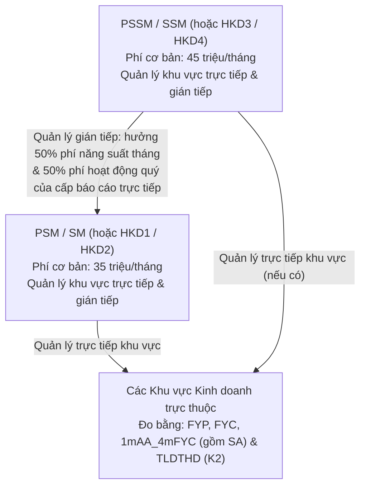

# Policy Knowledge Base — Manulife Việt Nam: Quản Lý Cấp Cao (`PSM+`) & Hộ Kinh Doanh (`HKD`) (2026)

**Nguồn Ground Truth đã đọc trọn 6/6 trang:**
- `SRC-POL-MNL-001`: `0048M01/2026/ASBD` (ngày gửi 23/01/2026, hiệu lực 01/01/2026, thay thế `0003M04/2024/ASBD`, đánh dấu `INTERNAL`, ký bởi Phó TGĐ Điều Hành Kênh Đại Lý Manish Sangal) [6 trang].

> **Cảnh báo Phạm vi (Scope Boundary):** Bộ tài liệu hiện tại **CHỈ bao phủ tầng Quản lý Cấp cao (`PSM+`) và mô hình đối tác Hộ Kinh Doanh (`HKD`)** của Manulife Việt Nam — **CHƯA có** chính sách thu nhập Đại lý cá nhân (FA), Quản lý cấp trung (UM/SUM/DM) và Biểu hoa hồng sản phẩm. Mọi kết luận về Manulife ở đây chỉ áp dụng cho tầng `PSM+ / HKD`.

---

## 1. Manulife đang tổ chức tầng Quản lý Cấp cao theo mô hình nào?

- **Mô hình Lãnh đạo Khu vực Chuyên nghiệp & Pháp nhân hóa Hộ Kinh Doanh (`PSM+ ↔ HKD`):**
  - Cho phép lãnh đạo khu vực lựa chọn hoặc chuyển đổi linh hoạt giữa 2 hình thức pháp lý: ký **Hợp đồng Dịch vụ Quản lý Cấp cao (`HĐDV QLCC` — `PSM/SM`, `PSSM/SSM`)** với tư cách cá nhân (Manulife khấu trừ thuế TNCN) HOẶC ký **Hợp đồng Dịch vụ Hộ Kinh Doanh (`HĐDV HKD` — `HKD1/2`, `HKD3/4`)** (HKD xuất hóa đơn chứng từ & tự chịu nghĩa vụ thuế theo pháp luật).
  - Toàn bộ kết quả sản xuất, nghĩa vụ và **khoản trả chậm 3 năm (Phí hợp tác dài hạn)** được **bảo lưu liên tục 100%** khi chuyển đổi qua lại giữa `PSM+` và `HKD` (`p.5`, Mục C.5–C.8).

---

## 2. Cấu trúc Cấp bậc & Mối quan hệ Quản lý

- **Chốt cấu trúc:** Cấu trúc khu vực trực tiếp và cấp báo cáo trực tiếp được chốt vào **cuối mỗi tháng** (cho phí tháng) và **tháng cuối quý** (cho phí quý).

---

## 3. Cấu trúc 4 Khoản Phí Dịch vụ & Lộ trình Siết Chất lượng từ 04/2026

| STT | Khoản phí dịch vụ | Công thức & Mức chi trả | Điều kiện, Sàn, Trần & Cơ chế đặc thù | Nguồn |
|---|---|---|---|---|
| **I** | **Phí dịch vụ Cơ bản hàng tháng** *(Target-linked Base Fee)* | `Phí cơ bản (35tr hoặc 45tr) × % Hoàn thành chỉ tiêu FYP (trực tiếp + gián tiếp) × 130%` | • **Sàn kích hoạt:** Tỷ lệ hoàn thành chỉ tiêu FYP phải **≥ 30%** (dưới 30% = `0đ`). • **Trần tối đa:** **150%** phí cơ bản (`52.5tr/M` cho PSM/HKD1–2; `67.5tr/M` cho PSSM/HKD3–4 — đạt trần khi đạt `115.4%` chỉ tiêu FYP!). | `p.1` |
| **II** | **Phí dịch vụ Năng suất Tháng** *(Direct & Indirect FYC Override)* | • **Trực tiếp:** `FYC khu vực × (6% nếu <115% FYP \| 8% nếu ≥115% FYP) × Hệ số TLDTHD (K2)`. • **Gián tiếp:** **50%** trên Phí năng suất tháng thực nhận của cấp báo cáo trực tiếp. | Không có sàn FYP tối thiểu ở phần 6%, nhưng chịu **Hệ số nhân TLDTHD (K2)** siết cực mạnh từ tháng 04/2026 (xem bảng dưới). | `p.1-2` |
| **III** | **Phí dịch vụ Hoạt động Quý** *(Active Agent Override)* | • **Trực tiếp:** `FYC Quý khu vực × % theo % đạt chỉ tiêu 1mAA_4mFYC Quý × Hệ số TLDTHD cuối quý`. • Bậc `1mAA_4mFYC`: `90–<100%: 1.0%`, `100–<110%: 2.5%`, `110–<120%: 3.5%`, `≥120%: 5.0%`. • **Gián tiếp:** **50%** trên Phí hoạt động quý của cấp trực tiếp. | `1mAA_4mFYC` = đại lý có HĐ hiệu lực cuối tháng, **≥1 HĐ thực cấp** và **≥4 triệu FYC/tháng** (**bao gồm Đại lý phục vụ SA**). | `p.2-3` |
| **IV** | **Phí dịch vụ Hợp tác Dài hạn** *(3-Year Deferred Retention Bonus)* | `75% × Tổng (Phí II + Phí III thực nhận từ khu vực trực tiếp) + 25% × Tổng (Phí II + Phí III từ khu vực gián tiếp)`. • **Trần:** Tối đa **12 lần Phí cơ bản tháng** (`420tr` hoặc `540tr/năm`, chốt chức danh T12). | **Điều kiện đạt năm Y0 (1 trong 2):** (1) FYP năm ≥85% & K2 T12 ≥70%; HOẶC (2) Khu vực trực tiếp thuộc **Top 15 toàn quốc** về FYP & K2 T12 ≥70% *(xét K2 trước khi xếp Top 15!)*. **Lịch trả rải 3 năm vào kỳ tháng 4:** **30% (Y1) – 30% (Y2) – 40% (Y3)** với điều kiện **K2 tổng khu vực T12 năm liền trước ≥70%** và HĐ còn hiệu lực! Áp dụng hồi tố điều kiện chi trả cho các đợt Y2/Y3 còn lại của năm 2024 & 2025! | `p.3-5` |

### Điểm nhấn quan trọng: Bước ngoặt Siết Chất lượng TLDTHD (K2) từ Tháng 04/2026 (`p.2-3`)

| TLDTHD (K2) của khu vực | Trước tháng 04/2026 | **Từ tháng 04/2026 trở đi** | Mức độ thay đổi (Phân tích) |
|---|---|---|---|
| `≥ 80%` | 115% | **110%** | Giảm 5 điểm % thưởng trần (kiểm soát chi phí) |
| `75% – <80%` | 115% | **105%** | Giảm 10 điểm % |
| `70% – <75%` | 110% | **100%** | Chuẩn hòa vốn 100% bị **đẩy lên từ 60% → 70%**! |
| `65% – <70%` | 105% | **90%** | Từ thưởng +5% chuyển sang phạt -10% |
| `60% – <65%` | 100% | **70%** | **Bị cắt mạnh -30% thu nhập!** |
| `50% – <60%` | 75% – 90% | **50%** | **Bị cắt một nửa thu nhập!** |
| `< 50%` | `TLDTHD thực đạt` | **`TLDTHD thực đạt / 2`** | **Phạt chia đôi** (VD: K2 40% chỉ còn hệ số **20%**) |
| Chưa có TLDTHD | 100% | **100%** | Bảo vệ khu vực mới mở |

---

## 4. Cách tăng thu nhập — Khi nào bị giảm / mất thu nhập

- **3 đòn bẩy tăng thu nhập tối ưu cho PSM+/HKD:**
  1. **Đạt ≥ 115% chỉ tiêu FYP tháng:** Đồng thời chạm sát trần **150% Phí cơ bản** (vì `115.4% × 130% = 150%`) VÀ nhảy bậc Phí năng suất tháng từ `6% → 8%` (+33% tỷ lệ override!).
  2. **Giữ TLDTHD (K2) ≥ 70% (mục tiêu ≥ 80%):** Vừa nhận hệ số `100%–110%` hàng tháng/quý, vừa mở khóa **Phí hợp tác dài hạn 3 năm** (tối đa thêm 420–540 triệu/năm!).
  3. **Tập trung năng lực cho Khu vực trực tiếp:** Phí hợp tác dài hạn tính **75%** trên phần trực tiếp nhưng chỉ **25%** trên phần gián tiếp (khuyến khích quản lý sát thực địa thay vì chỉ ngồi hưởng tầng gián tiếp).
- **4 kịch bản bị cắt / mất thu nhập:**
  1. Đạt `<30%` chỉ tiêu FYP tháng → **mất 100% Phí cơ bản tháng**.
  2. TLDTHD tụt xuống dưới 70% từ 04/2026 → vừa bị trừ nặng hệ số tháng/quý (tụt xuống 70% → 50% → K2/2), vừa **mất sạch quyền xét Phí hợp tác dài hạn năm đó VÀ mất đợt giải ngân 30%/40% của các năm trước!**
  3. Chấm dứt HĐDV (không chuyển sang HKD/PSM+ tương ứng) → mất toàn bộ các đợt trả chậm 3 năm còn lại.
  4. Vi phạm quy định ảnh hưởng kết quả biểu phí → Manulife giữ quyền **thu hồi (clawback) ngay cả sau khi đã chấm dứt HĐDV và HĐĐL** (`p.6`, Mục C.11).

---

## 5. Ví dụ Minh họa Tính toán Thực tế (Từ Quy tắc Gốc)

> **Tình huống:** Một **PSM (Phí cơ bản 35tr)** quản lý trực tiếp 1 khu vực đạt **115% chỉ tiêu FYP** mỗi tháng, tạo ra **300 triệu FYC/tháng** (`900tr/quý`, `3,600tr/năm`), đạt **110% chỉ tiêu 1mAA_4mFYC** mỗi quý, không có khu vực gián tiếp. So sánh sau tháng 04/2026 ở 2 mức K2:
> - **Trường hợp A — Chất lượng cao (`K2 = 80%`, hệ số `110%`):**
>   - Phí cơ bản tháng: `min(35 × 115% × 130%, 35 × 150%) = min(52.325, 52.5) = 52.325tr/tháng` (`627.9tr/năm`).
>   - Phí năng suất tháng: `300tr × 8% × 110% = 26.4tr/tháng` (`316.8tr/năm`).
>   - Phí hoạt động quý: `900tr × 3.5% × 110% = 34.65tr/quý` (`138.6tr/năm`).
>   - **Phí hợp tác dài hạn (ghi nhận cuối năm, trả trong 3 năm sau):** `min(75% × (316.8 + 138.6), 12 × 35) = min(341.55, 420) = 341.55 triệu` (trả `102.47tr` Y1, `102.47tr` Y2, `136.62tr` Y3 nếu giữ K2 ≥ 70%).
>   - **Tổng giá trị kiếm được năm Y0:** `627.9 + 316.8 + 138.6 + 341.55 = 1,424.85 triệu` (nhưng tiền mặt chi ngay trong năm Y0 chỉ là `1,083.3tr` — tiết kiệm **24% dòng tiền ra** năm 1 để giữ chân 3 năm!).
> - **Trường hợp B — Chất lượng kém (`K2 = 60%`, hệ số `70%`):**
>   - Phí cơ bản tháng vẫn `52.325tr` (`627.9tr/năm` — *điểm đáng chú ý: Phí cơ bản không gắn hệ số K2!*).
>   - Phí năng suất tháng giảm còn `300 × 8% × 70% = 16.8tr` (`201.6tr/năm`).
>   - Phí hoạt động quý giảm còn `900 × 3.5% × 70% = 22.05tr/quý` (`88.2tr/năm`).
>   - **Phí hợp tác dài hạn = `0đ`** (rớt cổng K2 ≥ 70%!).
>   - **Tổng thu nhập giảm mạnh `-507.15 triệu/năm` (`-35.6%`)** chỉ vì K2 tụt từ 80% xuống 60%!

---

## 6. Nghĩa vụ Tài chính Ngắn hạn & Dài hạn + Điểm Cần Lưu ý

- **Ngắn hạn:** Phí cơ bản bị chặn trần cứng 150% và sàn 30%, kết hợp kiểm soát FYC biến đổi ở mức vừa phải (`6–8%` tháng + `1–5%` quý) giúp kiểm soát chi phí quản lý cấp cao khá dự đoán được.
- **Dài hạn (3 năm):** Khoản Phí hợp tác dài hạn (trần 420–540tr/người/năm) tạo nghĩa vụ dự phòng 3 năm (30/30/40% trả vào tháng 4), nhưng được bảo vệ bằng điều kiện tái kiểm tra `K2 ≥ 70%` mỗi năm.
- **2 điểm cần chú ý nghiệp vụ:**
  1. Định nghĩa `FYP` tại trang 6 **vẫn bao gồm `6%` phí đóng thêm (Top-up)** — cần kiểm tra sự tương thích khi Thông tư 96/2026/TT-BTC siết hoa hồng phí đóng thêm có hiệu lực 01/01/2027.
  2. Điều khoản mở C.1 (`p.5`): từ **tháng 02/2026**, PSM+/HKD phải hoàn thành thêm **"Yêu cầu về hoạt động dịch vụ"** quy định tại thông báo sau (chưa có trong bộ file).
